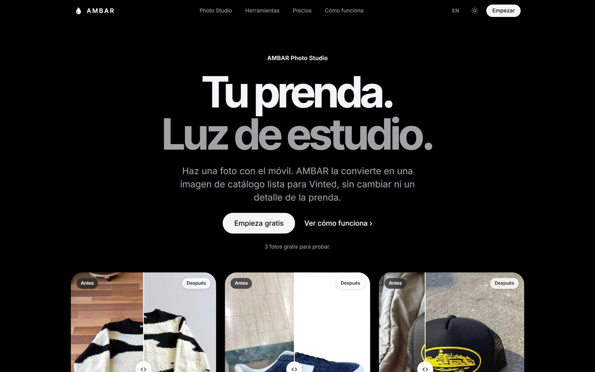
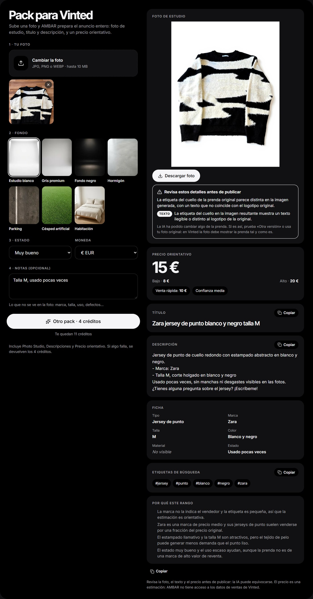
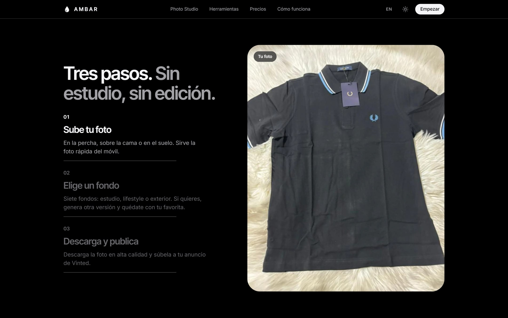
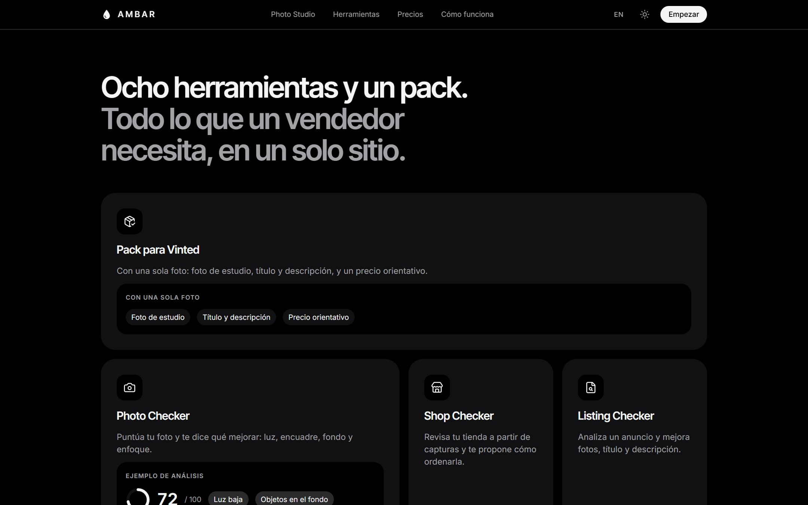
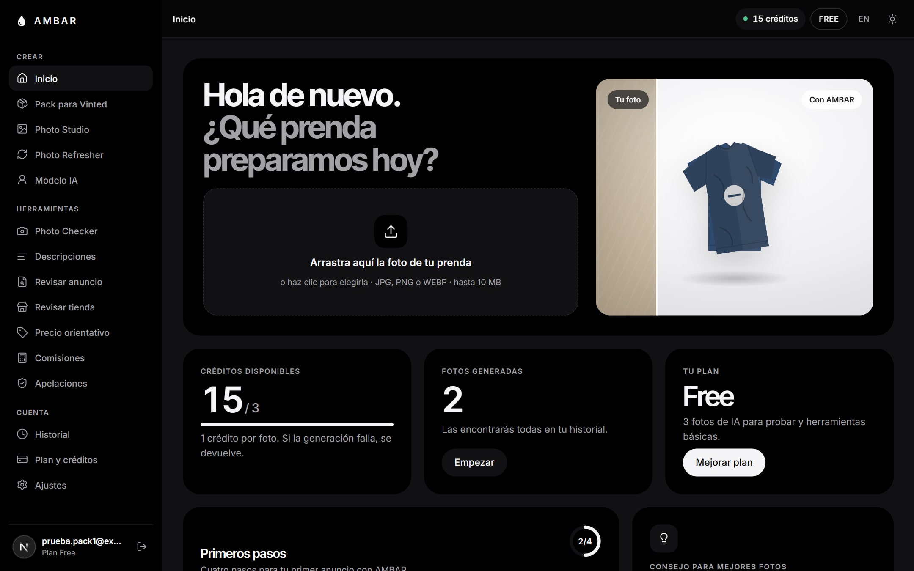
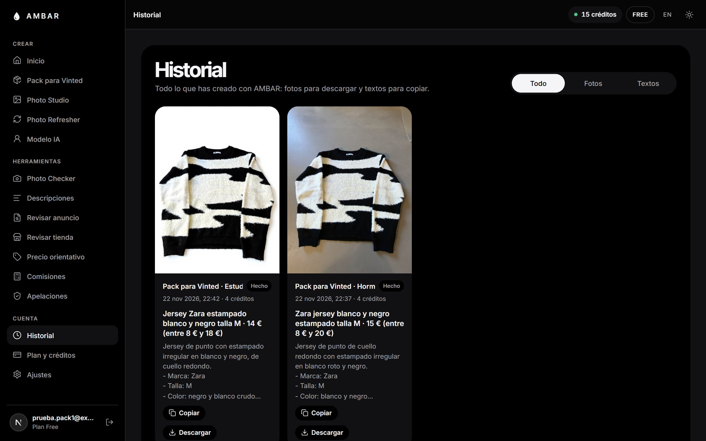
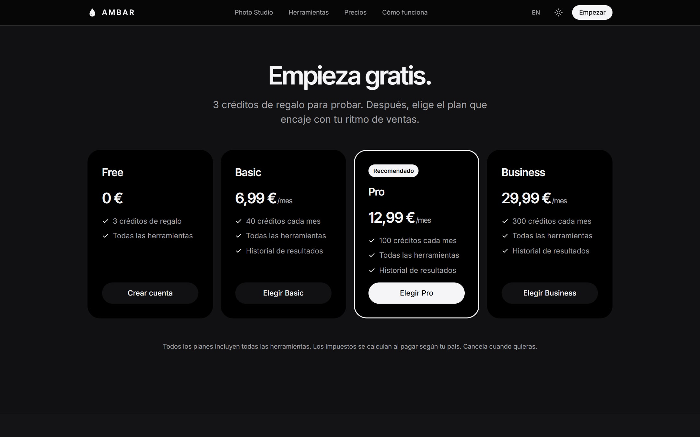
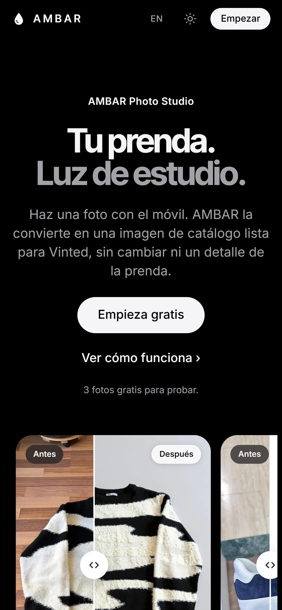

# AMBAR

**Fotos de estudio y anuncios listos para Vinted, con IA.**

Haz una foto de tu prenda con el móvil y AMBAR la convierte en una foto de catálogo, escribe el título y la descripción y te sugiere un precio. Sin cambiar ni un detalle de la prenda.

### [ambar-app-omega.vercel.app](https://ambar-app-omega.vercel.app)

`En desarrollo` · `Español e inglés` · `Pagos en modo de pruebas`

> Este repositorio es el **escaparate** del proyecto: qué es, cómo se ve y en qué punto está. El código de la aplicación está en un repositorio privado.

---

## Qué hace

| Herramienta | Qué hace | Créditos |
|---|---|:---:|
| **Pack para Vinted** | Con una sola foto: foto de estudio, título y descripción, y precio orientativo | 4 |
| **Photo Studio** | Fondo de estudio o ambiente para tu prenda: blanco, gris, negro, hormigón, parking, césped o habitación | 1 |
| **Photo Refresher** | Mejora la luz, limpia lo que rodea a la prenda o endereza la foto | 1 |
| **Modelo IA** | Tu prenda puesta en un modelo generado con IA | 2 |
| **Descripciones** | Título, descripción, ficha y etiquetas de búsqueda, sin inventar datos | 1 |
| **Photo Checker** | Puntúa la foto y dice qué mejorar | 1 |
| **Revisar anuncio** | Mejora el título y la descripción de un anuncio | 1 |
| **Revisar tienda** | Ideas para ordenar tu tienda a partir de capturas | 1 |
| **Precio orientativo** | Un rango de precio según la prenda, la marca y el estado | 1 |
| **Apelaciones** | Ayuda a redactar una apelación clara y respetuosa | 1 |
| **Comisiones** | Calcula lo que te queda de cada venta | Gratis |

Al registrarte recibes **3 créditos** para probar. Si una herramienta falla, se devuelven los créditos.

## Capturas

### Pack para Vinted
Una foto entra; sale el anuncio entero. La foto pasa además por una **revisión automática**, que compara la prenda del original con la del resultado y avisa si la IA ha cambiado algo (aquí, la etiqueta del cuello).

### Cómo funciona

### Herramientas

### Panel

### Historial

### Planes

## Cómo está hecho

| Parte | Tecnología |
|---|---|
| Web | Next.js 16 (App Router), React 19, TypeScript, Tailwind CSS 4, Motion |
| Idiomas | next-intl (español e inglés) |
| Cuentas, base de datos y fotos | Supabase (Postgres con RLS, Auth y almacenamiento privado) |
| Fotos con IA | FLUX Kontext y Nano Banana 2 (vía fal.ai) |
| Textos, análisis y control de calidad | Claude Haiku 5.5 (Anthropic) |
| Pagos | Polar, como vendedor (merchant of record) |
| Captcha | Cloudflare Turnstile |
| Alojamiento | Vercel |

### Decisiones que importan
- **La prenda no se toca.** Los modelos se eligieron con un banco de pruebas propio con fotos reales, y cada foto generada pasa una revisión automática de logos, textos, colores, estampados y forma.
- **No se inventan datos.** Marca, talla o material solo aparecen si se leen en una etiqueta o los escribe el vendedor.
- **Privacidad.** Antes de procesar una foto se le quita la ubicación (GPS) y el resto de metadatos. Las fotos se guardan en almacenamiento privado y cada usuario solo puede ver las suyas. Al borrar la cuenta se borra todo.
- **Créditos seguros.** Los créditos se reservan antes de cada trabajo y se devuelven si falla. Hay un límite de trabajos por minuto y por hora, y un pedido nunca suma créditos dos veces.
- **Sin scraping.** AMBAR no accede a Vinted: las revisiones de tienda funcionan con capturas.

## En qué punto está

- [x] Photo Studio con 7 fondos y comparador antes/después
- [x] Diez herramientas más el Pack para Vinted
- [x] Revisión automática de cada foto generada
- [x] Cuentas, historial, ajustes y borrar cuenta
- [x] Planes y packs de créditos con Polar (en modo de pruebas)
- [x] Textos legales (borrador)
- [ ] Dominio propio y verificación por email
- [ ] Cobros reales
- [ ] Fotos de ejemplo propias en la portada

## Novedades

**22 nov 2026**
- **Pack para Vinted:** foto de estudio, descripción y precio con una sola foto.
- **Borrar cuenta** desde Ajustes.
- **Textos legales:** aviso legal, privacidad, cookies y condiciones de uso.
- **Pagos con Polar** probados de principio a fin en modo de pruebas: packs, suscripciones y cancelación.
- **Precios nuevos:** Basic 6,99 €, Pro 12,99 €, Business 29,99 € al mes y pack de 20 créditos por 3,99 €.

**20 nov 2026**
- Las diez herramientas, el historial, el plan y los ajustes.
- Revisión automática de las fotos.
- Primera versión publicada, con captcha y límite de uso.

**19 nov 2026**
- Comienzo del proyecto, identidad visual y banco de pruebas de modelos de imagen.

---

**English** · AMBAR is an AI tool for Vinted sellers: studio-quality photos, listing descriptions and suggested prices from a single phone photo, without changing the item. In development, available in Spanish and English: [ambar-app-omega.vercel.app](https://ambar-app-omega.vercel.app)

AMBAR no está afiliado a Vinted.

